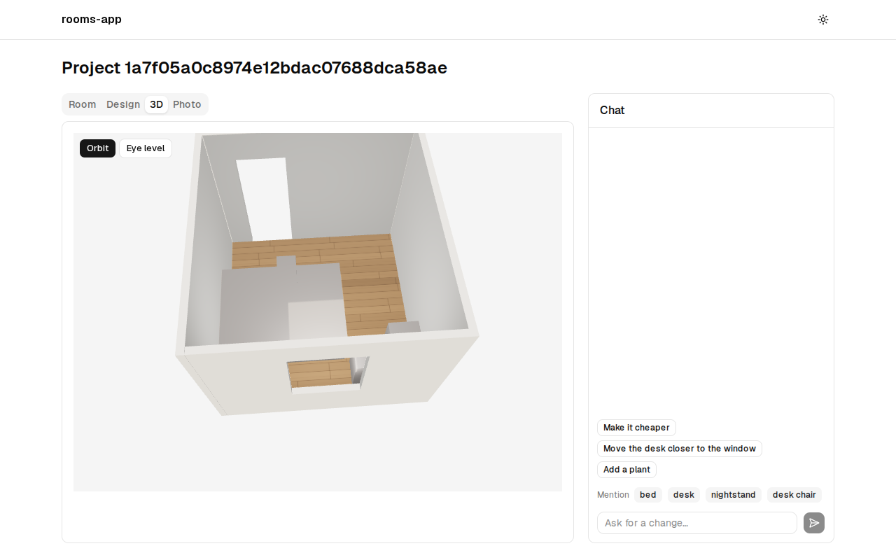
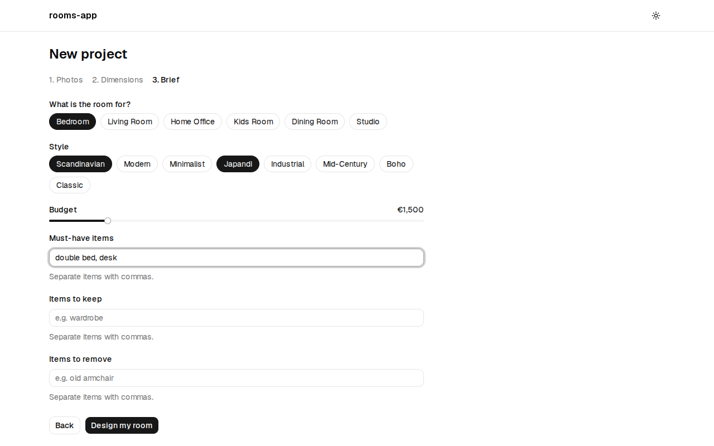
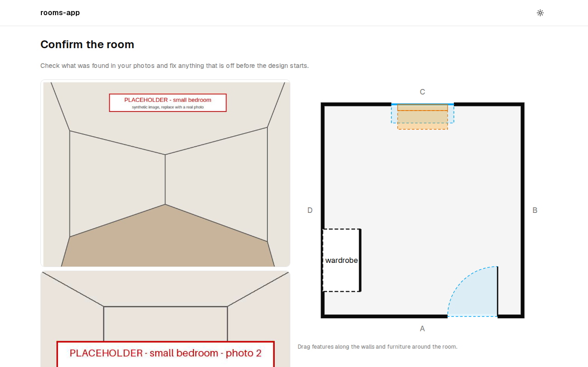
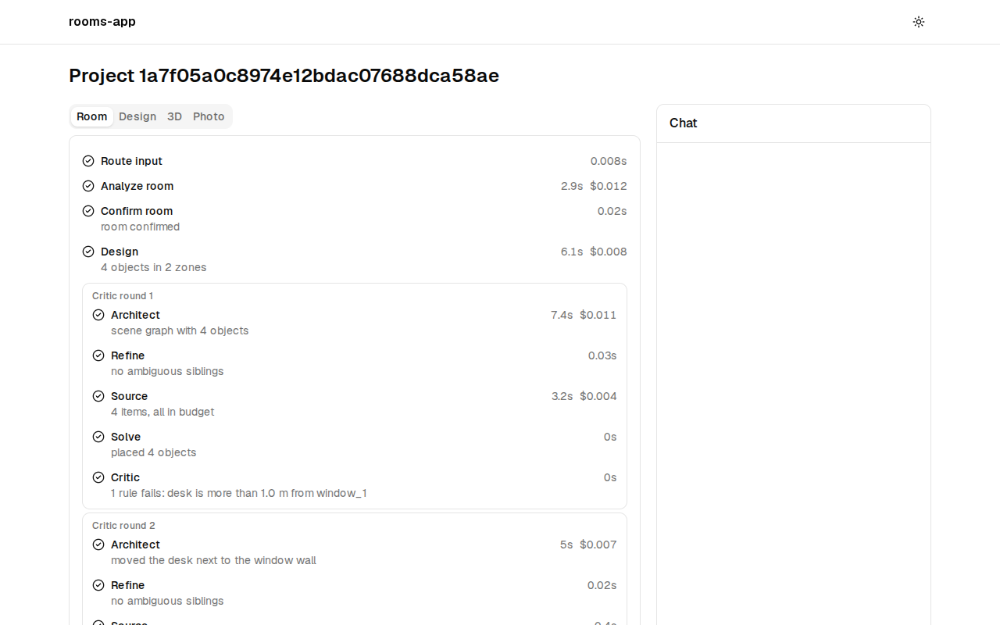
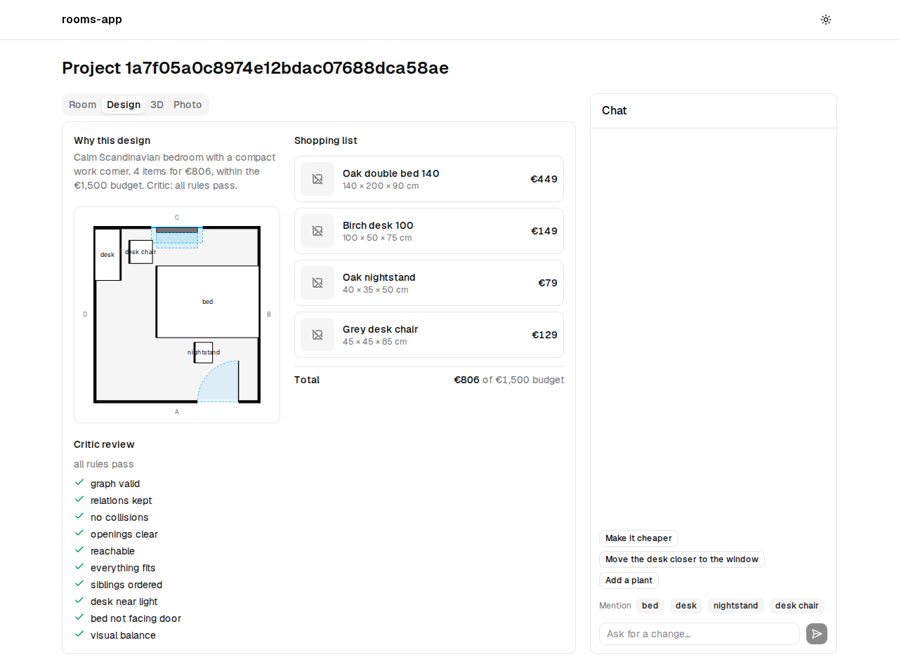
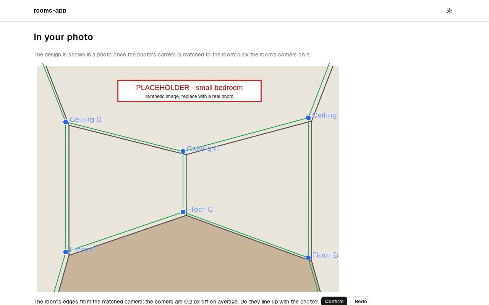
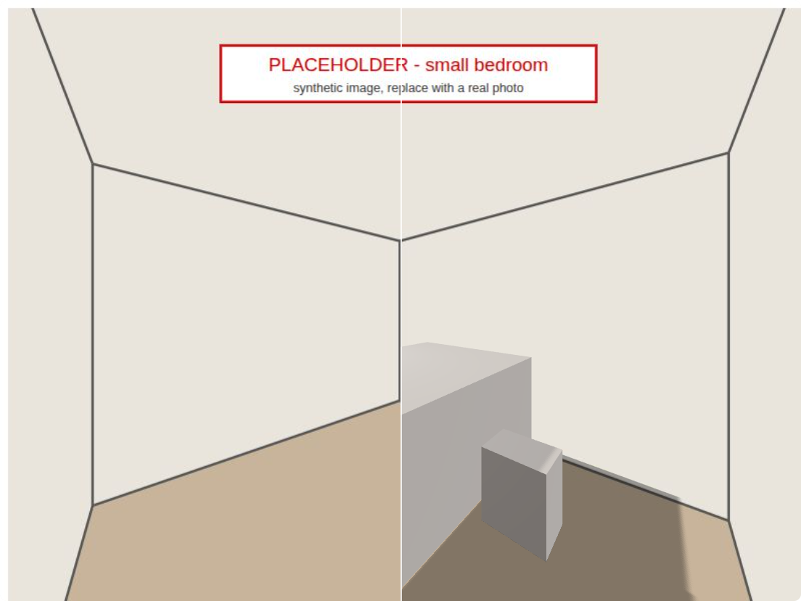
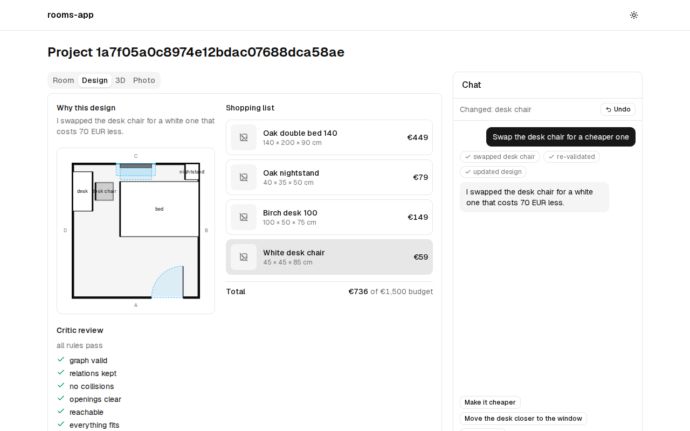
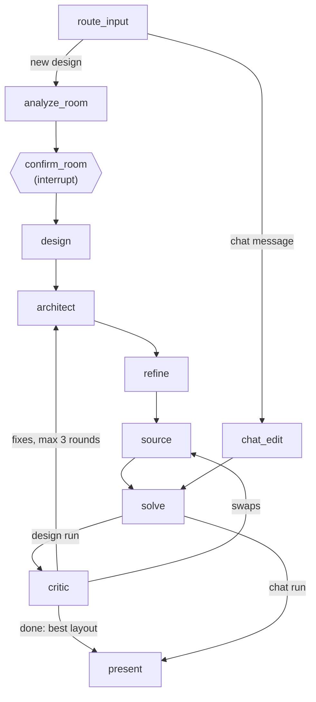

# rooms-app

An AI room-design assistant. You upload photos of a room and give its dimensions and a brief (use, style, budget, must-haves).
A team of LLM agents then furnishes the room with real catalog items. A geometric solver places the furniture, and a Critic checks
the layout and sends it back for fixes. You get a floor plan, a 3D view, the design drawn into your own photo and a shopping list.
You can then ask for changes in the chat.

[](docs/demo/demo.webm)

[Demo video](docs/demo/demo.webm) (webm, 6.8 MB: GitHub offers it as View raw / download; 77 s, recorded on `make dev-stub`: fixture replay, no model calls) ·
[Slides](docs/slides.md) ([PDF](docs/slides.pdf)) · [Architecture](docs/architecture.md) · [Evaluation](docs/evaluation.md) ·
[Contributing](CONTRIBUTING.md) · [Project board](https://github.com/users/Nelev/projects/1)

| Brief | Confirm the room | Live run |
| --- | --- | --- |
|  |  |  |
| **Design** | **Camera match, then the design in your photo** | **Chat edit** |
|  |   |  |

## How it works

1. **Wizard**: 1 to 3 photos, the room's width, length and ceiling height, then the brief.
2. **Confirm the room**: the Room Analyst (a vision model) reads walls, doors, windows and radiators from the photos. The run pauses
   so you can correct the result in a floor-plan editor.
3. **Design**: the Designer plans zones and objects. The Architect turns them into a scene graph of spatial relations, the Refiner
   orders siblings and the Sourcer picks catalog items within budget. A backtracking solver places them, and the rule-based Critic
   sends fixes back for up to 3 rounds, keeping the best layout. The timeline streams each step live.
4. **3D**: orbit and eye-level views of the result.
5. **Photo**: click 4 or more room corners on a photo to match its camera, then see the new furniture drawn into it.
6. **Chat**: "swap the desk chair for a cheaper one". A tool-calling agent edits the design, the solver re-validates it and you
   can undo it.



Next.js 16 frontend → FastAPI + LangGraph backend → Postgres (checkpointer, store, registry), S3-compatible storage (MinIO) and
models through OpenRouter. See [docs/architecture.md](docs/architecture.md) for the system diagram, every node and the repo layout.

## Quick start

You need [uv](https://docs.astral.sh/uv/), Node 24 with [pnpm](https://pnpm.io/) (`corepack enable`), and Docker for Postgres.
`make` is optional: each target is a couple of commands in the [Makefile](Makefile).

### 1. Without keys: `make dev-stub` (free)

```sh
git clone https://github.com/Nelev/rooms-app.git && cd rooms-app
make dev-stub
```

Open http://localhost:3000 and click **New project**. The API (http://localhost:8000/health) runs the whole graph from fixtures,
with the fake model, in memory. No Postgres, no keys and nothing spent. Whatever photos and brief you enter, every model-backed
step replays `fixtures/small-bedroom` (a 3.2 x 3.4 m bedroom), slowed down to look live. The solver, Critic and presenter run for
real. This mode records the demo. Without `make`:

```sh
(cd backend && uv sync && DATABASE_URL= OPENROUTER_API_KEY= STUB_PACE=0.3 uv run uvicorn app.main:app --reload) &
(cd frontend && pnpm install && pnpm dev)
```

If ports 8000 or 3000 are taken, point the frontend at the API and let the API accept the frontend's origin:

```sh
(cd backend && DATABASE_URL= OPENROUTER_API_KEY= STUB_PACE=0.3 CORS_ORIGINS=http://localhost:3001 uv run uvicorn app.main:app --port 8001) &
(cd frontend && NEXT_PUBLIC_API_URL=http://localhost:8001 pnpm dev --port 3001)
```

### 2. With models: `make dev`

```sh
cp .env.example .env   # the ROOT .env (gitignored); set OPENROUTER_API_KEY in it
make dev               # Postgres in Docker, then the API on :8000 and the frontend on :3000, with reload
```

- `.env` lives at the repo root, never in `backend/` or `frontend/`. `make dev`, `make eval` and docker compose read it.
- `DATABASE_URL` in `.env.example` points at the compose database on `localhost:5432`. If that port is taken, start the database
  with `DB_PORT=5433 docker compose up -d --wait db` and change the port in `DATABASE_URL`.
- Without `OPENROUTER_API_KEY`, `make dev` still works on Postgres with stub nodes, and the catalog search store stays empty (a
  warning at startup).
- `STORAGE_*` is optional. Without it, photos are saved in `backend/.uploads/`. `LANGSMITH_*` is optional tracing.

> **Live runs cost money.** With a key, every design run calls real models through OpenRouter (the larger model for the Room
> Analyst and the Architect). The paid pilot measured $0.025 (single LLM) and $0.033 (graph without the Critic) per run; a full run with the Critic loop
> (up to 3 rounds) was not measured live and likely costs more. `make eval` and `make ablate` also read `.env`, so with a
> key they run live over many cases. Use `--fake` to stay offline (see [evaluation](docs/evaluation.md)).

### 3. Everything in containers

```sh
cp .env.example .env
docker compose up -d --build   # Postgres, API and frontend; open http://localhost:3000
```

`DB_PORT`, `BACKEND_PORT` and `FRONTEND_PORT` change the host ports. The frontend image calls the API at `http://localhost:8000`,
so keep `BACKEND_PORT` at 8000. On main the backend image is built from `backend/` alone, without `fixtures/` and `data/catalog/`
at the repo root, so design runs inside it fail. Use `make dev-stub` or `make dev` for now. Task I-01 is finishing the compose
stack: MinIO, and an end-to-end Playwright suite that replays recorded LLM responses. Once it lands, the demo can also be
re-recorded on that stack.

## Testing

```sh
make test   # backend pytest (offline: fixtures, FakeLLM, fake embeddings) and frontend vitest
make lint   # ruff format --check, ruff check, mypy; Biome and tsc
make gen    # regenerate contracts/ and the frontend's API types after changing a schema or a route
```

- Tests never call a model unless they are marked `live`. With a key in the environment, run those with
  `cd backend && uv run pytest -m live`. They cost money.
- Eval and ablations: [docs/evaluation.md](docs/evaluation.md). For example, `make eval VARIANT=full` or
  `make ablate ARGS="--fake --repeats 1"`.
- Re-record the demo and the screenshots against a running `make dev-stub` (needs `pnpm --dir frontend exec playwright install chromium`):
  `BASE_URL=http://localhost:3000 pnpm --dir frontend exec node ../docs/demo/record.ts`.

## Evaluation

The agent graph is compared with a LayoutGPT-style single-LLM baseline and with ablations, on 25 room cases. It uses
deterministic layout metrics (I-Design's out-of-bounds and overlap, clearance, blocked openings, budget, must-haves) and
I-Design's VLM judge. A small paid pilot ($0.27, [eval/results/pilot/](eval/results/pilot/)) has run so far:

| Variant | Runs | Cost / run | Time / run | Clearance pass | Budget fit | Must-haves | Judge layout (0-10) |
| --- | --- | --- | --- | --- | --- | --- | --- |
| `baseline` (single LLM) | 3 | $0.025 | 17 s | 0.97 | 1 | 1 | 4.1 |
| `no_critic` | 3 | $0.033 | 56 s | 0.92 | 1 | 1 | 4.4 |
| `full` | failed (fixed since, offline only) | n/a | n/a | n/a | n/a | n/a | n/a |
| `analyst_mode` | not run | n/a | n/a | n/a | n/a | n/a | n/a |


**Caveats.** These are 3 rooms with 1 repeat, and only 2 of the 4 variants ran. The photos are synthetic placeholders, so the
analyst finds nothing. The judge graded grey box renders, and the human ratings for judge-human agreement are still pending. The
numbers check that the pipeline works. They do not show that one variant is better. Details and the full table:
[docs/evaluation.md](docs/evaluation.md).

## Related work

- **I-Design**: Ata Çelen, Guo Han, Konrad Schindler, Luc Van Gool, Iro Armeni, Anton Obukhov, Xi Wang.
  [*I-Design: Personalized LLM Interior Designer*](https://arxiv.org/abs/2404.02838), ECCV 2024 Workshops
  ([project page](https://atcelen.github.io/I-Design)). In I-Design, LLM agents turn a text description into a scene graph of
  objects and relations. A backtracking algorithm places the objects, assets are retrieved from a database, and a VLM evaluator
  grades the result. rooms-app follows the same scene graph + backtracking design and reuses its metrics and judge protocol. It
  adds real photos and a confirmed room (walls, doors, windows, kept furniture), a priced catalog and budget, a closed Critic
  loop that keeps the best round, and chat edits.
- **LayoutGPT**: Weixi Feng, Wanrong Zhu, Tsu-jui Fu, Varun Jampani, Arjun Akula, Xuehai He, Sugato Basu, Xin Eric Wang, William Yang
  Wang. [*LayoutGPT: Compositional Visual Planning and Generation with Large Language Models*](https://arxiv.org/abs/2305.15393),
  NeurIPS 2023. In LayoutGPT, an LLM predicts layouts directly (CSS-like boxes from in-context examples), including 3D indoor
  scenes. Our E-03 baseline (`eval/baselines/single_llm.py`) is in this style: one call places the furniture as absolute positions.

## Limitations

- The fixture and eval photos are synthetic placeholders, so the Room Analyst has not yet been measured on real photos.
- Only 4 of the 223 catalog items have a 3D model. Everything else renders as a box.
- The solver places each object by its first relation only. Other relations, such as the Refiner's ordering edges, are checked
  but not enforced.
- There is no authentication: run it locally.

## Contributing

See [CONTRIBUTING.md](CONTRIBUTING.md) for the branch, PR and parallel-agent rules, and [fixtures/README.md](fixtures/README.md)
for the sample data.
