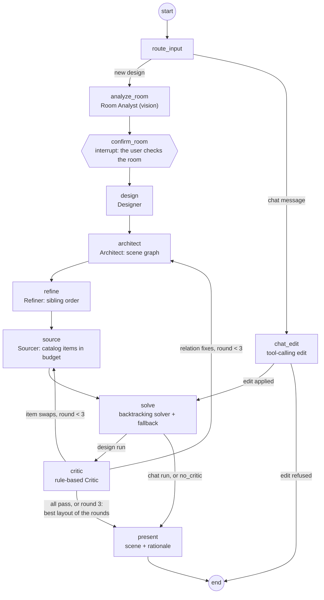

# Architecture

rooms-app is a LangGraph agent graph behind a FastAPI API, with a Next.js frontend. This page explains how the pieces fit. The
code's docstrings hold the details, and each section names the modules to read.

## System

```mermaid
flowchart LR
  user([Browser]) -->|HTTP + SSE| fe[Next.js 16 frontend<br/>wizard, plan, 3D, photo, chat]
  fe -->|REST, run streams| api[FastAPI<br/>backend/app/api]
  api --> graph[LangGraph graph<br/>backend/app/graph]
  graph -->|checkpointer, store,<br/>projects registry| pg[(Postgres + pgvector)]
  api -->|photos, renders| s3[(S3-compatible storage<br/>MinIO / any S3)]
  graph -->|chat, vision, embeddings| or[OpenRouter]
  graph -.->|traces, optional| ls[LangSmith]
```

- **Frontend** (`frontend/`): Next.js 16 (App Router), Tailwind 4, shadcn/ui on Base UI, react-three-fiber for 3D. The browser calls the
  API directly (`NEXT_PUBLIC_API_URL`, default `http://localhost:8000`). Types come from `contracts/openapi.json` (`make gen`).
- **API** (`backend/app/api/`): threads (`/threads`), run streams (`POST /threads/{id}/runs/stream`, Server-Sent Events, and
  `GET /threads/{id}/runs/current/stream` to reconnect), a run's result (`GET /threads/{id}/runs/{run_id}/result`), photo uploads,
  camera matching (`POST /threads/{id}/camera-pose`) and catalog items.
- **Postgres** (pgvector image): LangGraph's checkpointer (each thread's state and history), the LangGraph store (catalog
  embeddings for search) and the projects registry. Without `DATABASE_URL` everything is in memory (`make dev-stub`, tests).
- **Object storage**: photos, renders and GLBs. Set `STORAGE_ENDPOINT_URL` to use an S3-compatible bucket (MinIO locally).
  Without it, uploads go to `backend/.uploads/` and the API serves them.
- **OpenRouter**: every model call goes through the gateway in `backend/app/llm/` (`get_llm(role)`): one model per role, with
  usage and cost read from each response. `FakeLLM` stands in for it in tests and in the stub graph.

## The agent graph

One thread is one project. Its first run designs the room. Each later chat message starts another run on the same thread.



`backend/app/graph/graph.py` builds the graph. `routing.py` holds the conditional edges. Each node is a module in
`graph/nodes/`.

| Node | Model | What it does |
| --- | --- | --- |
| `route_input` | none | Sends the first input to the design branch and each chat message to `chat_edit` |
| `analyze_room` | vision (`analyze_room` role) | Reads walls, doors, windows and radiators from the photos, wall by wall. It reads the room several times and keeps the features most readings agree on. The typed dimensions are the room's |
| `confirm_room` | none | A LangGraph `interrupt`: the run pauses until the user confirms or corrects the room in the editor (`/projects/{id}/room`) |
| `design` | `design` role | The Designer: zones, palette and the objects to add. Code then adds any missing must-have and drops extras until the objects fit the free floor area (I-Design's main failure is overfilling) |
| `architect` | `architect` role | Turns the design into a scene graph. Walls, doors and windows are fixed roots, and the model gives the edges (`against_wall`, `in_front_of`, `left_of`...). Checked by the B-07 validator and repaired once |
| `refine` | none | Orders siblings that share a parent and a relation (`right_of` edges), so the solver has a single reading |
| `source` | none (catalog search) | Picks a catalog item per object within each object's share of the budget. Critic swaps ("smaller", "cheaper", "shorter") exclude the current item |
| `solve` | none | Places the scene graph by randomized backtracking (`app/geometry/solver.py`). The fallback (`fallback.py`) drops or shrinks what does not fit. It then validates collisions, clearances, blocked openings, the ceiling and every relation. The seed is the critic round, so runs are reproducible |
| `critic` | none (rule-based) | Turns the validation into hard issues, adds soft rules (desk near light, bed not facing the door, visual balance) and sends actions to the Architect or the Sourcer |
| `present` | none | Builds the render-ready `Scene` (`app/scene/builder.py`), the total, the budget and the rationale |
| `chat_edit` | `chat_edit` role, tool calling | A small ReAct loop inside the node: the model calls tools (`graph/chat_tools.py`: `get_layout`, `move_item`, `rotate_item`, `swap_item`, `add_item`, `remove_item`, `explain`) on the current design with the other items pinned. The run ends with a `LayoutDiff`. A refused edit leaves the design unchanged |

### The critic loop

The Critic scores each round as (hard issues, soft issues). `routing.keep_best` remembers the best round so far. Fewer hard issues
win, then fewer soft issues, and ties keep the earlier round. The loop ends when the critique asks for nothing or after
`MAX_ROUNDS = 3` rounds. In either case the best round's design is restored, not the last one. Actions go back to the Architect
(relation fixes) or to the Sourcer (item swaps), so only the stages that need to change run again.

### Stub and live nodes

`app/graph/stub.py` lets the whole graph run offline. Without `OPENROUTER_API_KEY`, each model-backed node replays its step from
`fixtures/small-bedroom/` (output and stream events) through `FakeLLM`. That is how `make dev-stub`, CI and most tests run. The
deterministic nodes (`refine`, `solve`, `critic`, `present`) always run for real. A node calls `stub.live(node)` to decide, so a
test can make a single node real. `STUB_PACE` slows the replay down so the UI looks live.

### Ablation flags

A run's `configurable` carries the ablation flags (`RunConfigurable` in `app/api/models.py`):

- `no_critic` skips the Critic: `solve` goes straight to `present`.
- `analyst_mode` makes the Room Analyst read the photos once instead of voting over several readings.

The eval runner uses them (see [evaluation.md](evaluation.md)).

## Data contracts

The domain models (`backend/app/schemas/`, Pydantic v2) are the source of truth. These include `RoomSpec`, `Brief`,
`DesignBrief`, `SceneGraph`, `Layout`, `Scene`, `CameraPose`, `StreamEvent`, `RunOutput` and `ChatEdit`. `make gen` exports them
to JSON Schema (`contracts/schemas/`) and OpenAPI (`contracts/openapi.json`), then generates the frontend's TypeScript types. Tests
fail when the contracts are stale. `fixtures/` holds one consistent example of every model per room ([fixtures/README.md](../fixtures/README.md)).

## Frontend flow

| Route | What it shows |
| --- | --- |
| `/` | The projects (threads) |
| `/projects/new` | The wizard: photos, dimensions, brief. Submitting uploads the photos and starts the design run |
| `/projects/{id}` | Tabs. **Room**: the live run timeline (SSE), photos and plan. **Design**: rationale, floor plan, Critic review, shopping list. **3D**: orbit and eye-level views. **Photo**: the composite. The chat panel sits beside the tabs |
| `/projects/{id}/room` | The room editor that answers `confirm_room`: drag features along walls, edit sizes, keep or delete furniture |
| `/projects/{id}/photo` | Camera matching (click 4 or more room corners, then OpenCV `solvePnP` on the API), then the design drawn into the photo with a before/after wipe |
| `/render/{runId}` | A bare 3D render for headless capture (the eval's corner renders) |

## Repository layout

```
backend/            FastAPI app and LangGraph graph (uv)
  app/api/          HTTP routes
  app/graph/        graph, routing, state, stub switch, nodes/
  app/geometry/     room geometry, scene-graph validator, solver, fallback, layout checks
  app/catalog/      catalog loader, embeddings store, search
  app/llm/          OpenRouter gateway, FakeLLM
  app/schemas/      domain models (source of the contracts)
  app/scene/        render-ready scene builder
  app/vision/       camera pose from clicked corners (OpenCV)
  tests/            pytest (offline; `-m live` for real models)
frontend/           Next.js 16 app (pnpm)
contracts/          JSON Schema and OpenAPI generated from the backend
fixtures/           sample data per room case, used by tests, mocks and the stub graph
data/catalog/       the furniture catalog (223 items)
eval/               dataset, metrics, single-LLM baseline, VLM judge, runner, ablations, results
docs/               this documentation, slides, demo video and screenshots
```
