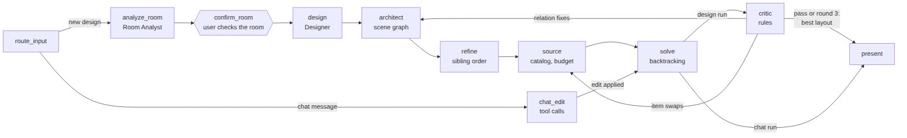
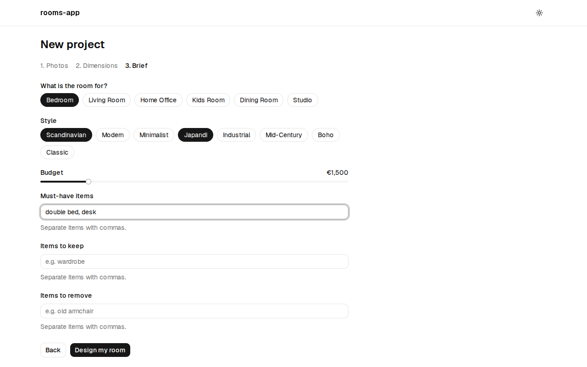
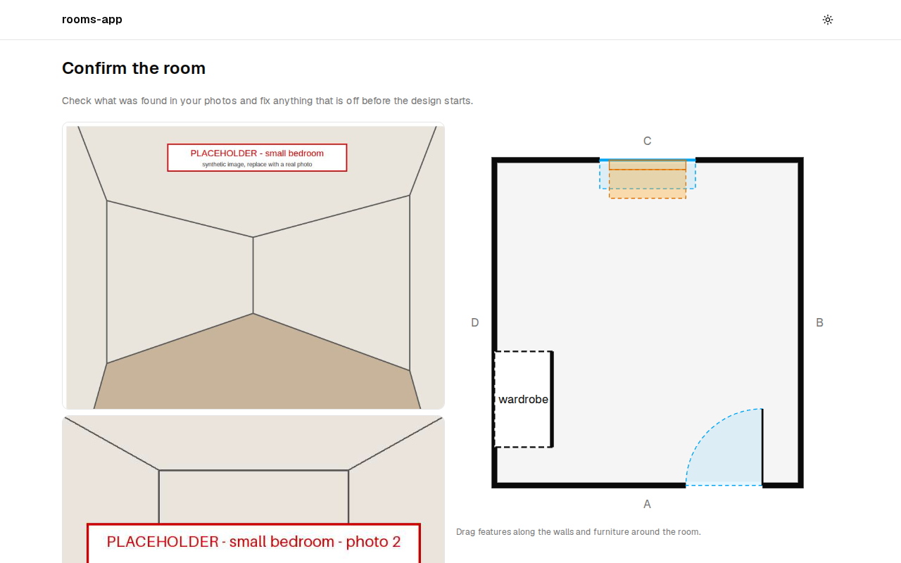
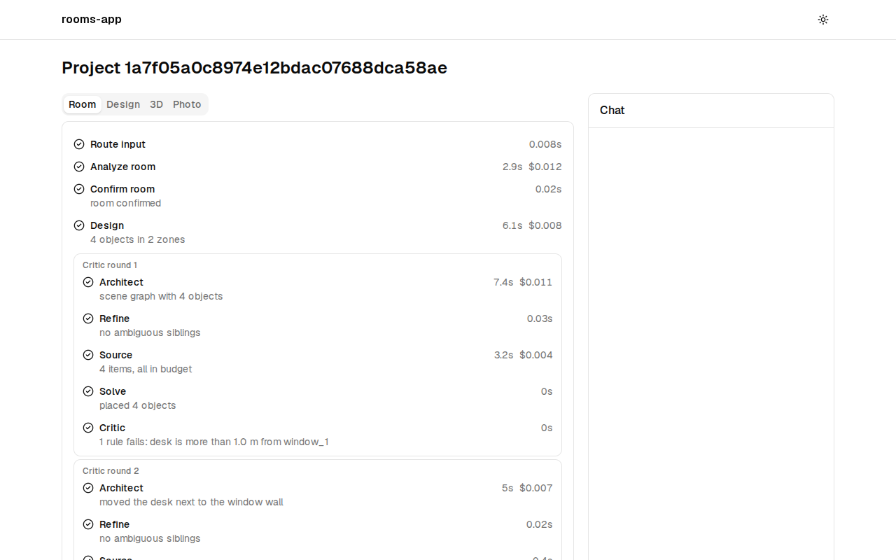
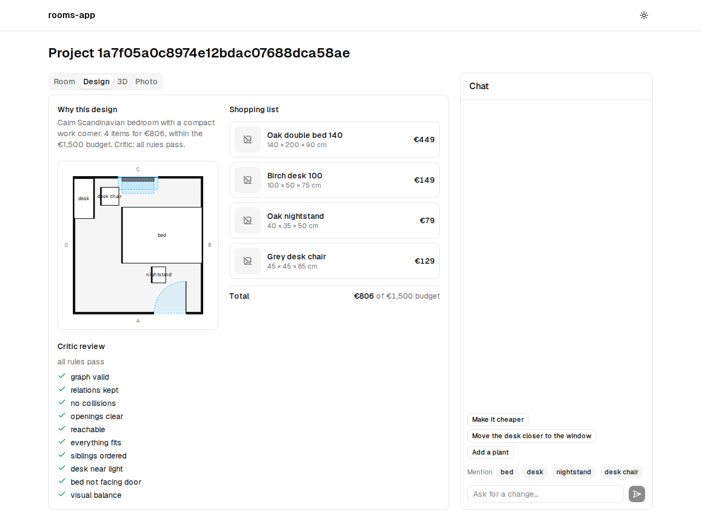
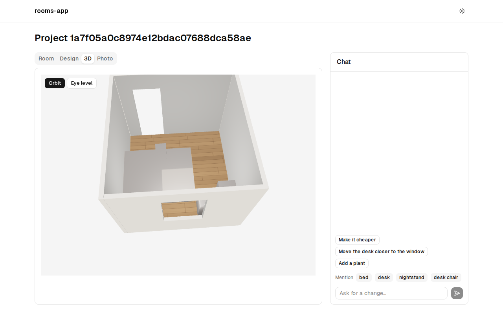
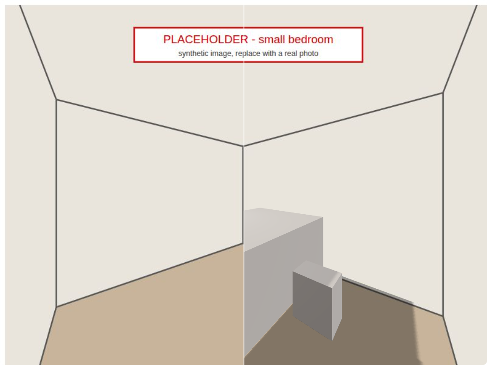

<!-- Export (from the repo root): npx @marp-team/marp-cli --no-stdin docs/slides.md --html --pdf --allow-local-files -o docs/slides.pdf
     It needs a Chrome: CHROME_PATH=<Playwright's chromium> and, where unprivileged sandboxes are blocked, CHROME_NO_SANDBOX=1. -->

# rooms-app

**An AI room-design assistant:** photos of a room in, a furnished, priced and checked design out.

LangGraph agents · a geometric solver · a rule-based Critic · Next.js + three.js

---

# The problem

- Furnishing a room means satisfying many constraints together: the room's real shape, its doors, windows and radiators, the furniture you keep, a budget, a style and what must fit.
- A single LLM call that writes coordinates (LayoutGPT-style) produces layouts that look plausible but can collide, block doors or overfill the room.
- Multi-agent designers (I-Design) start from text alone. They do not see your room, your budget or a priced catalog, and you cannot correct them along the way.

**Goal:** a design for *your* room that is physically valid, within budget, made of buyable items and editable by talking to it.

---

# Approach

1. **Read the room** from the photos with a vision model, then **ask the user to confirm it** (human in the loop).
2. **Plan, then place**: agents decide *what* goes *where relative to what* (a scene graph). A solver computes the coordinates.
3. **Check and fix**: a Critic validates the solved layout and sends targeted fixes back, for up to 3 rounds, keeping the best.
4. **Show it** as a floor plan, in 3D and in your own photo, with a shopping list.
5. **Edit by chat**: a tool-calling agent changes the design and the solver re-validates it.

---

# Architecture

FastAPI + LangGraph (Postgres checkpointer and store) · Next.js 16 frontend with live run streams (SSE) · S3/MinIO for photos · models through OpenRouter · fully offline stub mode (fixture replay + fake model)

---

# The agents

| Node | Kind | Role |
| --- | --- | --- |
| Room Analyst | vision LLM, several readings voted | walls, doors, windows, radiators, with confidences |
| `confirm_room` | interrupt | the user corrects the room in a plan editor |
| Designer | LLM + code | zones, palette, objects; must-haves forced in, extras dropped until they fit |
| Architect | LLM + validator | scene graph edges (`against_wall`, `in_front_of`...), validated and repaired once |
| Refiner | code | orders siblings that share a parent and a relation |
| Sourcer | catalog search | one item per object within each object's share of the budget |
| Critic | rules | hard issues and soft rules; actions for the Architect or the Sourcer |
| Chat edit | LLM, tool calling | `move_item`, `swap_item`, `add_item`, `remove_item`... with the rest pinned |

---

# Solver and Critic

**Solver** (randomized backtracking)
- Walls, doors and windows are fixed roots. Each object is placed in the box its relation allows in its parent's frame.
- Rejects collisions, blocked openings and clusters that no longer fit. On a dead end it re-samples the group above.
- Fallback: drops or shrinks what cannot fit. The seed is the round, so runs are reproducible.

**Critic** (deterministic)
- Hard: graph errors, collisions, clearances, blocked openings, ceiling, broken relations, dropped must-haves.
- Soft: desk near light, bed not facing the door, visual balance.
- Scores each round (hard, soft) and **keeps the best round**, not the last. Stops when all pass or after 3 rounds.

---

# UI flow: wizard and room confirmation

Photos, dimensions and brief → the Room Analyst's reading, editable on a floor plan before anything is designed.

---

# UI flow: the run and the design

Every node streams its progress, cost and summary. The design shows its rationale, plan, Critic review and shopping list.

---

# UI flow: 3D, photo and chat

Click 4+ room corners → camera pose (OpenCV `solvePnP`) → the new furniture rendered into the photo. Then chat: "swap the desk chair for a cheaper one" → swapped, re-validated, undoable.

---

# Evaluation setup

- **25 cases**: bedrooms, living rooms, offices and 5 hard cases (tiny room, budget too low, three doors...).
- **Metrics**: I-Design's out-of-bounds and overlap, clearance pass rate, blocked openings, budget fit, must-have coverage, and the analyst's feature precision and recall.
- **VLM judge** (I-Design protocol): two corner renders + the brief → functionality, layout, color, atmosphere, realism (0-10).
- **Variants**: `baseline` (single LLM, LayoutGPT-style), `full`, `no_critic`, `analyst_mode`.
- Judge-human agreement script (Pearson, Spearman, Cohen's kappa) is ready, but the ratings are pending.

---

# Pilot results ($0.27 total)

| Variant | Runs | Cost/run | Time/run | Clearance | Budget fit | Must-haves | Judge layout |
| --- | --- | --- | --- | --- | --- | --- | --- |
| baseline | 3 | $0.025 | 17 s | 0.97 | 1 | 1 | 4.1 |
| no_critic | 3 | $0.033 | 56 s | 0.92 | 1 | 1 | 4.4 |
| full | crashed (fixed, unverified live) | | | | | | |
| analyst_mode | not run | | | | | | |

**Caveats:** 3 rooms × 1 repeat · 2 of 4 variants · synthetic placeholder photos (analyst recall 0) · the judge saw grey box renders · human ratings pending. These numbers check the pipeline. They are not a result.

---

# Limitations

- No real room photos yet, so the Room Analyst has not been measured on real input.
- 4 of 223 catalog items have 3D models; the rest render as boxes (this hurts the judge's realism grades).
- The solver enforces only each object's first relation. Other relations are checked, not enforced.
- The pilot is too small to compare variants. A full study is about $12 to $20.
- Local only: no authentication or deployment yet.

---

# Next steps

1. Run the missing variants, then the full study (4 variants × 25 cases × 3 repeats, judged).
2. Collect human ratings and report judge-human agreement.
3. Real photos for the fixtures and the dataset, and more GLB models in the catalog.
4. Let the solver honour all relations (multi-edge constraints), so the Refiner's ordering takes effect.
5. docker-compose stack with MinIO and end-to-end tests on recorded LLM responses (I-01), then deployment.

---

# Thank you

Demo video: `docs/demo/demo.webm` · Code: github.com/Nelev/rooms-app

References:

- Çelen et al., *I-Design: Personalized LLM Interior Designer*, ECCV 2024 Workshops (arXiv:2404.02838)
- Feng et al., *LayoutGPT: Compositional Visual Planning and Generation with Large Language Models*, NeurIPS 2023 (arXiv:2305.15393)
